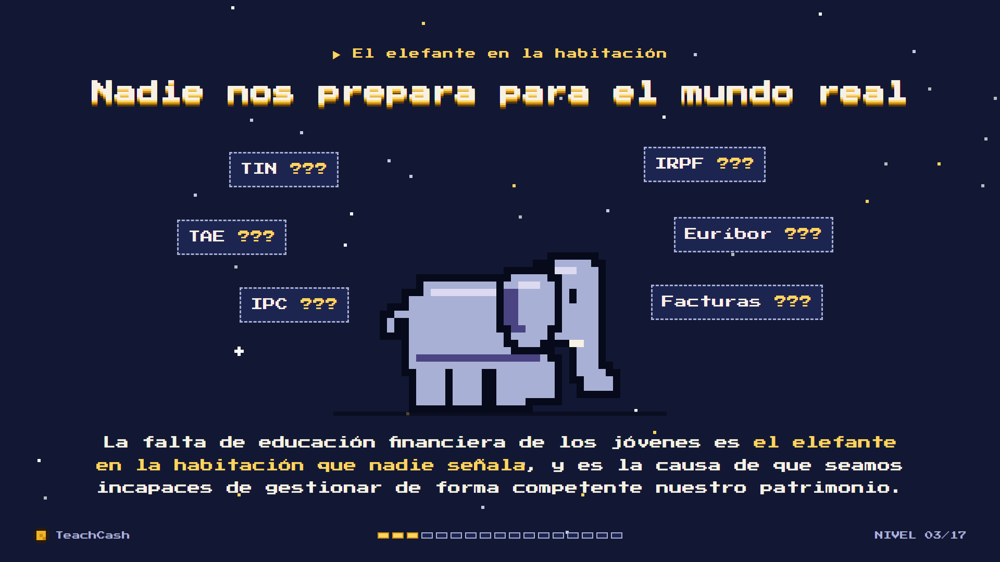
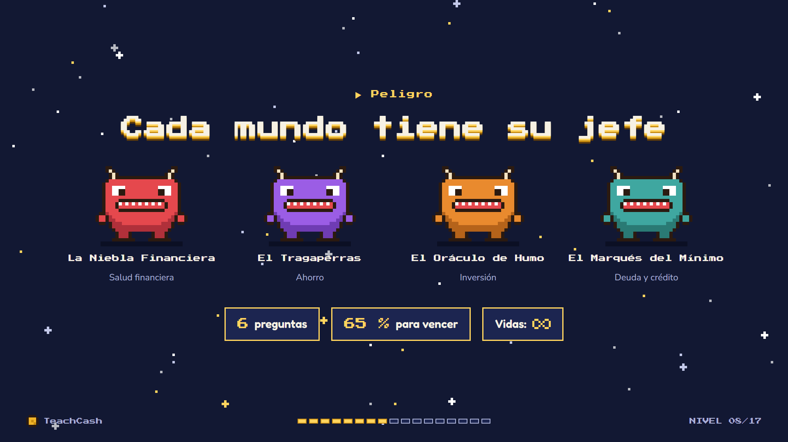
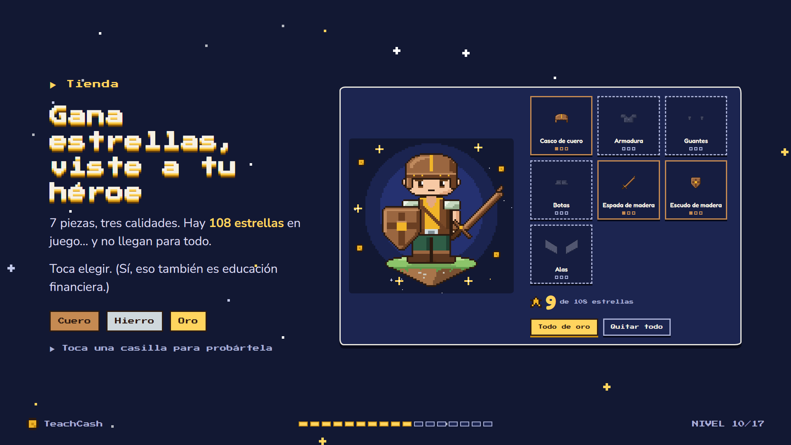
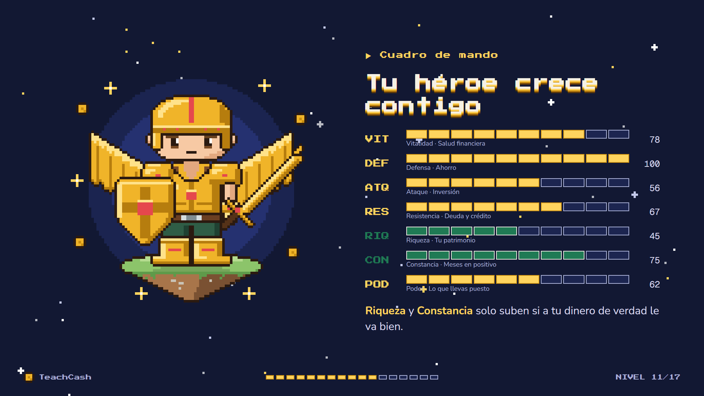

<div align="center">

# 🪙 TeachCash

### Educación financiera al alcance de cualquiera… jugando.

**Un videojuego a píxel para aprender a manejar tu dinero, y un gestor de finanzas para aplicarlo con el tuyo.**
Gratis, sin registrarte y en tres minutos por nivel.

[**▶ Jugar ahora en www.teachcash.es**](https://www.teachcash.es)
&nbsp;·&nbsp; [**Presentación**](#-presentación-y-vídeo)
&nbsp;·&nbsp; [**Vídeo**](#-presentación-y-vídeo)
&nbsp;·&nbsp; [**Stack tecnológico**](#-el-stack-tecnológico)
&nbsp;·&nbsp; [**Stack de IA**](#-el-stack-de-ia-cómo-se-ha-construido-teachcash)

<br>


<sub>Trabajo de Final de Máster · **The Big School** · Jose Recatalá Pesudo</sub>

</div>

---

## 🐘 El problema

¿Quién te enseñó a manejar el dinero? A mí, nadie.

En clase aprendimos a resolver ecuaciones, pero no a leer una nómina, ni qué es
el TIN, la TAE o el IPC, ni a entender una factura. Y no es una sensación: según
el INE, **el 36,4 % de la gente en España no podría pagar un gasto imprevisto con
sus ahorros** (Encuesta de Condiciones de Vida 2025).

La falta de educación financiera de los jóvenes es el elefante en la habitación
que nadie señala. **TeachCash existe para señalarlo, y para hacer algo al
respecto.**



## 💡 La idea

Si no lo aprendimos en clase, lo aprendemos jugando. TeachCash se apoya en tres
palabras, y ninguna está de adorno.

🎮 **Interactivo.** Aquí no se lee un PDF eterno: se practica. Cada lección acaba
con un minitest y cada error trae su explicación, que es lo que de verdad enseña.

📚 **Veraz.** Las cifras y las normas son las de España y salen de fuentes
oficiales: Banco de España, CNMV, INE, Seguridad Social, Tesoro Público y BOE.
Cada dato lleva su fuente y pasa una revisión. Para mí, **un dato mal es un bug**,
igual que un importe mal sumado.

⭐ **Lúdico.** Mundos, jefes, estrellas, una tienda y un héroe que es solo tuyo.
Aprender tiene que apetecer tanto como jugar el siguiente nivel.

> Es contenido educativo, no asesoramiento financiero, y la aplicación lo
> recuerda en todo el módulo.

---

## 🕹️ Funcionalidades principales

### 1. El Camino del héroe

El corazón de TeachCash. **Cuatro mundos**, cada uno un planeta a píxel, abiertos
desde el principio: empiezas por el que más te preocupe.


| Mundo | Lo que aprendes |
|---|---|
| ❤️ **Salud financiera** | Saber dónde estás: ingresos, gastos, presupuesto, la nómina por dentro y el patrimonio |
| 🐷 **Ahorro** | El colchón para imprevistos, dónde guardar el dinero (cuentas, depósitos, Letras del Tesoro) y cómo crece solo |
| ⛰️ **Inversión** | Riesgo y diversificación, fondos indexados, el efecto de las comisiones y cómo cazar un chiringuito |
| 💳 **Deuda y crédito** | Lo que cuesta de verdad un préstamo, las tarjetas revolving, la hipoteca y cómo salir de una deuda |

Dentro de cada mundo hay un **camino de nueve niveles** que se recorre en orden.
Las 📖 **lecciones** son tres o cuatro minutos de lectura con un minitest al
final. Las 🎮 **prácticas** son casos reales, los de Pepito, el personaje de
todos los ejemplos, corregidos al momento: elegir una opción, verdadero o falso,
ordenar pasos, emparejar conceptos o rellenar el hueco. Y arriba del todo espera
el 👾 **jefe**, el examen final del mundo, un monstruo de su color: seis preguntas
y un 65 % para tumbarlo. Si pierdes, lo vuelves a intentar. Aquí equivocarse es
gratis, que es justo lo que no pasa con el dinero de verdad.

Sin calculadora: se pregunta por la idea, no por la cuenta.




Cada nivel da de una a tres estrellas y se puede repetir para mejorar la marca.
**Corrige el servidor**, así que las estrellas valen lo que dicen.

### 2. La Tienda: gana estrellas, viste a tu héroe

Las estrellas se gastan en la Tienda: casco, armadura, guantes, botas, espada o
martillo, escudo y alas, en **cuero, hierro y oro**. Hay 108 estrellas en juego y
no llegan para todo, así que toca elegir. (Sí, eso también es educación
financiera.)

Las estrellas solo se ganan aprendiendo: inventarse movimientos no da ninguna.



### 3. El Cuadro de mando: tu héroe crece contigo

La portada de la aplicación: el héroe en su isla con todo su equipo, tu
patrimonio, tus estrellas y un radar con **siete estadísticas**. Los cursos suben
Vitalidad, Defensa, Ataque y Resistencia (una por mundo), y Poder sube con lo que
llevas puesto. Pero **Riqueza y Constancia solo suben si a tu dinero de verdad le
va bien**: el juego se cruza con tu vida.



### 4. Gestión de patrimonio: a tu dinero de verdad

TeachCash no se queda en el juego. El segundo módulo sirve para llevar tus
finanzas reales. En **Inicio** ves tu patrimonio, cómo va el mes frente al
anterior, la evolución del saldo, en qué se te va el dinero y los últimos
movimientos, con flechas para recorrer los meses. En **Movimientos** anotas un
gasto o un ingreso en dos segundos, con su categoría y su fecha, y los filtras
por periodo, categoría o texto, o te los llevas a Excel. Las **Categorías**,
de gasto o de ingreso, tienen su emoji y su color, que las identifican en la
tabla y en los gráficos. Y **Planificación** pone cada categoría de gasto frente
a su presupuesto del mes.

Hay una sola cuenta y una sola moneda: el patrimonio es la cifra con la que
empiezas más la suma de tus movimientos.


### 5. Sin excusas para empezar

Es **gratis** y **no hace falta registrarse**: entras y juegas, con una sesión de
invitado que nace al momento (protegida con un CAPTCHA invisible de Cloudflare
Turnstile) y dura 4 días. Si te gusta, creas una cuenta con email y contraseña y
conservas todo lo que llevas. Cada persona ve solo lo suyo y puede borrar su
cuenta, con todo lo que contiene, desde la propia aplicación.

---

## 🔑 Usuario de prueba

**No hace falta.** TeachCash se usa entero sin registrarse: al entrar en
[www.teachcash.es](https://www.teachcash.es) y pulsar **Jugar gratis** nace una
sesión de invitado con la que se puede probar **todo**: los cuatro mundos, la
tienda, el Cuadro de mando y la gestión de patrimonio. Crear una cuenta solo
sirve para conservar los datos más allá de los 4 días del invitado.

---

## 🌍 Despliegue

> 📄 **La información del despliegue está en [`docs/DESPLIEGUE.md`](docs/DESPLIEGUE.md).**

| | |
|---|---|
| **Aplicación en producción** | **[www.teachcash.es](https://www.teachcash.es)** |
| **Hosting** | Vercel, en París: cada merge a `main` se despliega solo |
| **Base de datos y auth** | Supabase (Postgres en la región eu-west-3, París) |
| **Anti-bots** | Cloudflare Turnstile, invisible |
| **Emails** | Resend, desde `no-reply@teachcash.es` |
| **Dominio** | `teachcash.es` (la raíz y `teachcash.vercel.app` redirigen a `www`) |

Ahí se cuenta cómo está montado, cómo llega un cambio a producción, qué
variables usa, cómo se comprueba que funciona y cómo se vuelve atrás. El paso a
paso con el que se montó, panel por panel, está en
[`docs/plans/PLAN-DESPLIEGUE.md`](docs/plans/PLAN-DESPLIEGUE.md).

## 🎬 Presentación y vídeo

| | |
|---|---|
| **Presentación en la web** | [www.teachcash.es/presentacion](https://www.teachcash.es/presentacion): hecha con las mismas piezas del juego, con sus animaciones. Se pasa con las flechas y **F** la pone a pantalla completa |
| **Presentación en Google Slides** | [Abrir la presentación](https://docs.google.com/presentation/d/1fgsaO5C3leoC9E_JZaVcdHqoboAiZN6i/edit?usp=sharing) |
| **Vídeo explicativo** | _enlace pendiente_ |
| **Repositorio** | [github.com/joseRecatalaa/TeachCash](https://github.com/joseRecatalaa/TeachCash) |

---

## 🚀 Instalación y ejecución en local

### Requisitos

Necesitas **Node.js 20.9 o superior** (lo exige Next.js 16) y **pnpm 10**
(`npm install -g pnpm`). Usa siempre `pnpm`: con `npm` o `yarn` se corrompe el
lockfile. Además, un proyecto de **Supabase** y un widget de **Cloudflare
Turnstile** en modo invisible; los dos tienen plan gratuito. Qué configurar en
cada panel está explicado en [`docs/plans/PLAN-SUPABASE.md`](docs/plans/PLAN-SUPABASE.md).

### Pasos

```bash
git clone https://github.com/joseRecatalaa/TeachCash.git
cd TeachCash
pnpm install                 # instala también el hook de commit (Husky)
cp .env.example .env.local   # y rellénalo: cada variable dice de dónde sale
pnpm db:migrate              # crea las tablas, RLS y políticas en Supabase
pnpm dev                     # → http://localhost:3000
```

Las variables de `.env.local` son estas (en [`.env.example`](.env.example) cada
una explica de qué panel sale):

| Variable | Qué es |
|---|---|
| `DATABASE_URL` | Conexión de Supabase por el *Transaction pooler* (puerto 6543), la que usa la app |
| `DATABASE_URL_MIGRATIONS` | Conexión por el *Session pooler* (puerto 5432), la que usan las migraciones |
| `NEXT_PUBLIC_SUPABASE_URL` | La URL del proyecto de Supabase |
| `NEXT_PUBLIC_SUPABASE_PUBLISHABLE_KEY` | La clave pública de Supabase |
| `NEXT_PUBLIC_TURNSTILE_SITE_KEY` | La clave del widget de Turnstile |
| `APP_URL` | La URL pública de la app. Obligatoria en producción; en local puede ir vacía |

No hay paso de semillas: cada usuario recibe sus categorías por defecto al nacer,
y los cursos se leen de `content/heroe/`.

Por último, una sola vez: en el SQL Editor de Supabase, con la extensión
`pg_cron` activada, ejecuta `db/sql/limpieza-invitados.sql`. Es el job que borra
cada hora los invitados caducados.

### Comandos

| Comando | Qué hace |
|---|---|
| `pnpm dev` | Servidor de desarrollo en `localhost:3000` |
| `pnpm build` / `pnpm start` | Build de producción y servirlo |
| `pnpm test` | Los tests de Vitest (sobre PGlite: no tocan Supabase) |
| `pnpm test:tz` | Los mismos tests en el huso horario de Kiritimati, que caza fechas mal tratadas |
| `pnpm test:coverage` | Los tests con los umbrales de cobertura |
| `pnpm test:e2e` | Los E2E con Playwright (necesitan `.env.e2e`) |
| `pnpm typecheck` / `pnpm lint` | Tipos y ESLint |
| `pnpm heroe:validar` | Valida el contenido de los cursos |
| `pnpm db:generate` / `pnpm db:migrate` | Generar y aplicar migraciones |
| `pnpm db:studio` | Explorador de la base de datos |
| `pnpm generate:crud` | Scaffolding completo de una entidad nueva |
| `pnpm presentacion:exportar` | Exporta la presentación a PDF y PNG (con la app en marcha) |

---

## 🗂️ Estructura del proyecto

```
TeachCash/
├── app/                     # Rutas de Next.js (App Router)
│   ├── page.tsx             #   / → portada pública sin sesión, Cuadro de mando con ella
│   ├── CaminoHeroe/         #   el juego: mapa de mundos, camino y niveles
│   ├── Tienda/              #   la tienda de equipo
│   ├── Patrimonio/          #   gestión de patrimonio: Inicio
│   ├── Movimientos/         #   movimientos (listado, crear, editar)
│   ├── Categorias/          #   categorías
│   ├── Planificacion/       #   presupuesto frente a gasto
│   ├── aprende/             #   cursos públicos, para Google
│   ├── presentacion/        #   la presentación del TFM
│   └── Login/, Registro/…   #   cuenta y contraseña
├── content/heroe/           # Los CURSOS, en JSON: un mundo por carpeta, un nivel por fichero
├── src/                     # Clean Architecture en cuatro capas
│   ├── types/               #   DTO y esquemas Zod compartidos
│   ├── infrastructure/      #   repositorios: el único sitio que valida, autoriza y escribe
│   ├── application/         #   Server Actions (la frontera), hooks y proveedores
│   └── presentation/        #   componentes, formularios y tablas declarados, pixel art
├── lib/                     # Dinero, fechas, formato, auth, CSP, estadísticas, tienda…
├── db/                      # Esquema de Drizzle, migraciones y SQL de mantenimiento
├── e2e/                     # Tests end-to-end con Playwright
├── test/                    # Andamiaje de Vitest (PGlite, mocks, render)
├── scripts/                 # Exportar la presentación a PDF, PNG y PPTX
├── docs/                    # Toda la documentación técnica (ver abajo)
│   └── presentacion/        #   la presentación exportada (PDF, PPTX, PNG)
├── .claude/skills/          # Las skills del agente de IA (ver el stack de IA)
├── AGENTS.md                # El contrato con el agente: reglas, trampas y decisiones
└── proxy.ts                 # Refresca la sesión y pone la CSP en cada petición
```

El mapa completo, fichero a fichero, está en [`docs/STRUCTURE.md`](docs/STRUCTURE.md).

### Documentación técnica

| Documento | De qué va |
|---|---|
| [`AGENTS.md`](AGENTS.md) | Las reglas duras del proyecto, las trampas y todas las decisiones tomadas |
| [`docs/DESPLIEGUE.md`](docs/DESPLIEGUE.md) | Cómo está desplegado, cómo se publica un cambio y cómo se comprueba |
| [`docs/ARCHITECTURE.md`](docs/ARCHITECTURE.md) | Las capas, cómo viajan los datos y la sesión |
| [`docs/COMPONENTS.md`](docs/COMPONENTS.md) | El sistema de diseño y los componentes reutilizables |
| [`docs/STRUCTURE.md`](docs/STRUCTURE.md) | Dónde va cada cosa |
| [`docs/TESTS.md`](docs/TESTS.md) | Cómo está montada cada suite de tests y qué cubre |
| [`docs/SECURITY.md`](docs/SECURITY.md) | Las medidas de seguridad, punto por punto de OWASP |
| [`docs/CONTENIDO-HEROE.md`](docs/CONTENIDO-HEROE.md) | Cómo se escribe un curso |
| [`docs/plans/`](docs/plans/) | Los planes con los que se construyó, el despliegue y los prompts de los cursos |

---

## 🧰 El stack tecnológico

TeachCash parece un juego, y por dentro es una aplicación de dinero hecha como
se hacen las de verdad. Cada pieza del stack está elegida por una razón, y esa
razón está escrita en [`AGENTS.md`](AGENTS.md). Aquí va entera, de la pantalla a
la base de datos.

### TeachCash en números

| | |
|---|---|
| 🧪 **1.545 tests** en 87 ficheros | Unitarios, de integración contra un Postgres real, de componentes y basados en propiedades, más E2E con Playwright |
| ✅ **0 avisos** en `pnpm audit` | Ni en producción ni en desarrollo. Lo que no tenía versión arreglada, se parchea en el repo |
| 🎯 **100 % de cobertura** en el núcleo | Dinero, fechas, formato, rutas, CSP y la corrección del héroe, con umbrales que el CI exige fichero a fichero |
| 🛡️ **OWASP Top 10 y API Top 10** | Auditoría de seguridad completa, punto por punto, en [`docs/SECURITY.md`](docs/SECURITY.md) |
| 🖼️ **0 imágenes** | Héroe, equipo, planetas, jefes y hasta el QR de la presentación están dibujados en código |
| 🌍 **4 mundos, 36 niveles, 108 estrellas** | Contenido en JSON, validado con Zod en cada PR |
| 💸 **0 €** de infraestructura | Todo en planes gratuitos. Lo único que se paga es el dominio |

### La arquitectura de un vistazo

```
 Navegador
   │  React 19 · Refine · Mantine · CSS Modules · pixel art en SVG
   ▼
 Server Actions ───────────── la frontera: sesión verificada y Zod en todo lo que entra
   │
   ▼
 Repositorios ─────────────── el único sitio que valida, autoriza y escribe
   │                          (filtro por usuario dentro de cada consulta)
   ▼
 Drizzle ORM ──► Postgres en Supabase (RLS de solo lectura, pg_cron)
```

Es **Clean Architecture en cuatro capas** (`types`, `infrastructure`,
`application` y `presentation`), y no es decoración: **ESLint impide** que una
capa importe de la que no debe. Las garantías viven en el servidor; lo que
comprueba un formulario es solo cortesía para ahorrar un viaje.

### 🎨 Interfaz

| Pieza | Por qué |
|---|---|
| **Next.js 16** (App Router, Turbopack) | Rutas, renderizado en servidor para las páginas públicas y Server Actions como transporte. Con `proxy.ts`, la nueva forma de Next 16 para el middleware |
| **React 19** + **TypeScript 5** en `strict` | Tipos de punta a punta, del esquema de la base a la pantalla |
| **Refine.dev 5** + **React Query 5** | CRUD declarativo: formularios y tablas se **declaran** en un fichero sin JSX y un formulario genérico los pinta. Una entidad nueva sale con `pnpm generate:crud` (Plop) |
| **Mantine 9** + `mantine-datatable` | Formularios, tablas y modales accesibles, con el tema dibujado a mano por encima |
| **CSS Modules** + tokens `--sd-*` | Un sistema de diseño propio (trazo de rotulador, sombra dura, esquinas asimétricas) con modo claro y oscuro en un solo bloque de tokens. Sin Tailwind, a propósito |
| **Fredoka, Nunito, Geist Mono y Press Start 2P** | Titulares, texto corrido, el dinero (cifras de ancho fijo, para compararlas en columna) y el mundo de píxel |
| **Recharts 3** | Evolución del saldo, gasto por categoría e ingresos frente a gastos, con una paleta validada con un script de contraste, no elegida a ojo |
| **SVG propio** para todo el pixel art | Sprites escritos como texto, pintados a escala entera para que se vean nítidos, animados con CSS y respetando `prefers-reduced-motion` |
| **xlsx** (SheetJS) | Movimientos a Excel, cargado solo al pulsar el botón |

### ⚙️ Servidor y datos

| Pieza | Por qué |
|---|---|
| **Server Actions** en vez de API REST | Menos superficie de ataque, ningún salto de red de más y la sesión se comprueba en un único sitio |
| **Postgres en Supabase** | Una base relacional de verdad para datos de dinero, en París, con RLS y `pg_cron` |
| **Drizzle ORM** + `postgres` | Consultas tipadas y migraciones versionadas, por el *Transaction pooler* de Supabase |
| **Zod 4** | Todo lo que llega del cliente se valida en el servidor: ids, filtros, páginas, importes y respuestas de los cursos |
| **El dinero en céntimos enteros** | Nunca un decimal: `0,1 + 0,2` da `0,3`. Con reparto de restos sin descuadres y formato `es-ES` solo al pintar |
| **Fechas civiles** (`AAAA-MM-DD`) | Un gasto no cambia de mes según la zona horaria de quien mira. Lo vigila una suite que corre en Kiritimati, la zona más adelantada del planeta |
| **Saldos derivados** | El patrimonio se calcula siempre desde los movimientos: no hay un saldo guardado que pueda mentir |
| **Corrección en el servidor** | Las respuestas de los niveles se corrigen en el servidor: las estrellas valen lo que dicen |

### 🔐 Seguridad

| Pieza | Por qué |
|---|---|
| **Supabase Auth** (`@supabase/ssr`) | Invitados anónimos y cuentas con email, con el JWT verificado (ES256) y la sesión comprobada en la base en cada acción |
| **Cookies `httpOnly`** | Ningún JavaScript puede leer la sesión |
| **CSP con nonce** | Un script inyectado no se ejecuta |
| **RLS de solo lectura** + `REVOKE` | La API pública de Supabase no sirve para leer lo ajeno ni para escribir nada |
| **Cloudflare Turnstile** | CAPTCHA invisible: los bots no crean invitados ni prueban contraseñas |
| **Límites y cuotas** | Por usuario, por IP y por cuenta, más un freno general si la base se acerca a su límite |

### 🧪 Calidad

| Pieza | Por qué |
|---|---|
| **Vitest** + **PGlite** | Los tests corren contra un **Postgres de verdad**, en WebAssembly y dentro del propio proceso, con las migraciones reales. Rápidos y sin tocar Supabase |
| **fast-check** | Tests basados en propiedades: miles de casos aleatorios contra las reglas del dinero |
| **Testing Library** | Componentes y hooks probados como los usa una persona |
| **Playwright** | Los flujos clave de punta a punta, contra un Supabase de pruebas |
| **ESLint** (con sonarjs) | Calidad, complejidad y las fronteras entre capas |
| **Husky** + lint-staged | ESLint y tipos en cada commit |
| **GitHub Actions** | CI en cada PR: tipos, lint, cobertura, la suite en otro huso horario, build y auditoría de dependencias. Acciones fijadas por SHA |
| **Dependabot** | Dependencias al día cada mes, agrupadas y con su CI |

### 🚀 Infraestructura

| Pieza | Por qué |
|---|---|
| **Vercel** | Despliegue automático de `main`, en París junto a la base |
| **Supabase** | Base de datos y autenticación gestionadas |
| **Resend** | Emails propios desde `no-reply@teachcash.es` |
| **DonDominio** | El dominio `teachcash.es` |
| **pnpm 10** | Instalaciones reproducibles con el lockfile congelado |

---

## 🤖 El stack de IA: cómo se ha construido TeachCash

TeachCash es un Trabajo de Final de Máster de **desarrollo con inteligencia
artificial**, y se nota en cómo está hecho. La IA no ha sido un autocompletado:
ha sido una compañera de equipo que planifica, programa, prueba, audita y
documenta. Pero con una regla que lo ordena todo: **la IA propone y el
repositorio decide.** Nada entra porque el agente diga que funciona; entra
porque pasa los tests, el CI y una revisión.

### Las herramientas

| Pieza | Herramienta | Qué hace en TeachCash |
|---|---|---|
| Agente de desarrollo | **Claude Code** (Anthropic), dentro de VS Code | Lee el código, planifica, programa, ejecuta los tests, revisa y abre las pull requests. De la idea al commit |
| El contrato con el agente | **`CLAUDE.md` + `AGENTS.md`** | Se cargan en cada sesión: las siete reglas duras que, rotas, dan bugs de dinero; las trampas que fallan en silencio, y cada decisión tomada con su porqué. Lo largo vive en `docs/`, partido por tarea, para no gastar contexto |
| Conocimiento experto | **7 skills propias** en `.claude/skills/` | Escritas para este proyecto: `money-and-currency`, `finance-data-model`, `server-action-safety`, `nextjs-app-conventions`, `testing-finance`, `finance-charts` y `bank-import-es`. El agente las carga solo cuando la tarea las pide |
| Criterio visual | **Skills de diseño**: `taste-skill`, `web-design-guidelines`, `awesome-design`, `apple-design` y `dataviz` | Dirección de arte, accesibilidad y gráficos. La paleta de colores de los gráficos se validó con el script de `dataviz`, no a ojo |
| Seguridad | **Skill de auditoría de seguridad** | La auditoría contra OWASP Top 10 y API Top 10 que dejó `docs/SECURITY.md` |
| Producción, sin riesgo | **MCP de Supabase**, en solo lectura y limitado al proyecto | El agente comprueba en la base real las políticas RLS, las migraciones, el job de limpieza y los avisos de seguridad, sin poder cambiar nada |
| Investigación | **Gemini Deep Research** | Un informe por mundo, con fuentes oficiales españolas (BOE, Banco de España, CNMV, Agencia Tributaria) |
| Trabajo en paralelo | **Subagentes** de Claude Code | Investigar un mundo, revisar las cifras de otro o auditar el código a la vez, cada uno con su contexto limpio |
| Contenido | **Claude** + el esquema Zod de los cursos | Convierte cada informe en los JSON de los niveles, que `pnpm heroe:validar` comprueba antes de entrar |

### Cómo se trabaja con ella

**Primero el plan, luego el código.** Cada bloque grande empezó con un plan
escrito junto al agente (están en [`docs/plans/`](docs/plans/), con los prompts
de los cursos incluidos) y se hizo por fases, cada una revisada antes del
commit.

**Un bug se arregla escribiendo primero el test que lo reproduce** y viéndolo en
rojo. Así la IA no puede "arreglar" algo que nadie ha demostrado que estuviera
roto.

**La documentación cambia en el mismo commit que el código.** `AGENTS.md` es la
memoria del proyecto: cuando se toma una decisión que no es obvia, se apunta con
su porqué, y la siguiente sesión empieza sabiéndola en vez de deshacerla.

### Las redes de seguridad

Una IA escribe rápido y se equivoca con mucha seguridad. Por eso el proyecto
está montado para que sus errores no lleguen lejos: más de 1.500 tests, algunos
**basados en propiedades** con fast-check (miles de casos aleatorios contra las
reglas del dinero); un **CI** que no deja mezclar nada en rojo; **ESLint** que
impide saltarse las capas de la arquitectura; **Husky** en cada commit; y, para
el contenido, **trazabilidad**: cada dato de cada curso tiene su fuente oficial
en el `FUENTES.md` de su mundo, y la lista de lo comprobado, con su norma y su
estado, está en [`REVISION-CIFRAS.md`](docs/investigación-heroe/REVISION-CIFRAS.md).

El resultado es un proyecto que una sola persona ha podido llevar a producción
con el rigor de un equipo, que es justo lo que este máster quería demostrar.

---

## 🗺️ Lo que viene

El Trabajo de Final de Máster se acaba. **El proyecto, no.** Voy a seguir con él:
👾 más mundos y más jefes, 🎮 más funcionalidades y, sobre todo, ❤️ formar una
comunidad alrededor de TeachCash.

<div align="center">

<br>

### Continue? ▶

**[www.teachcash.es](https://www.teachcash.es)**: tu héroe te está esperando.

</div>
