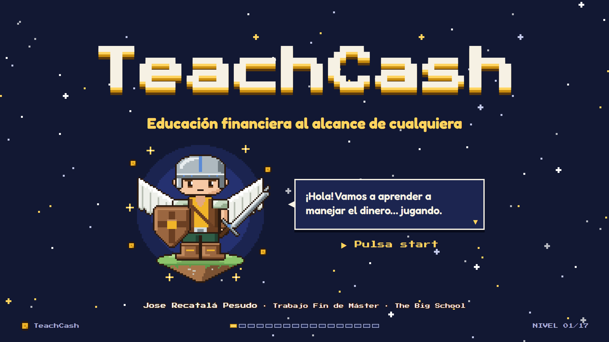
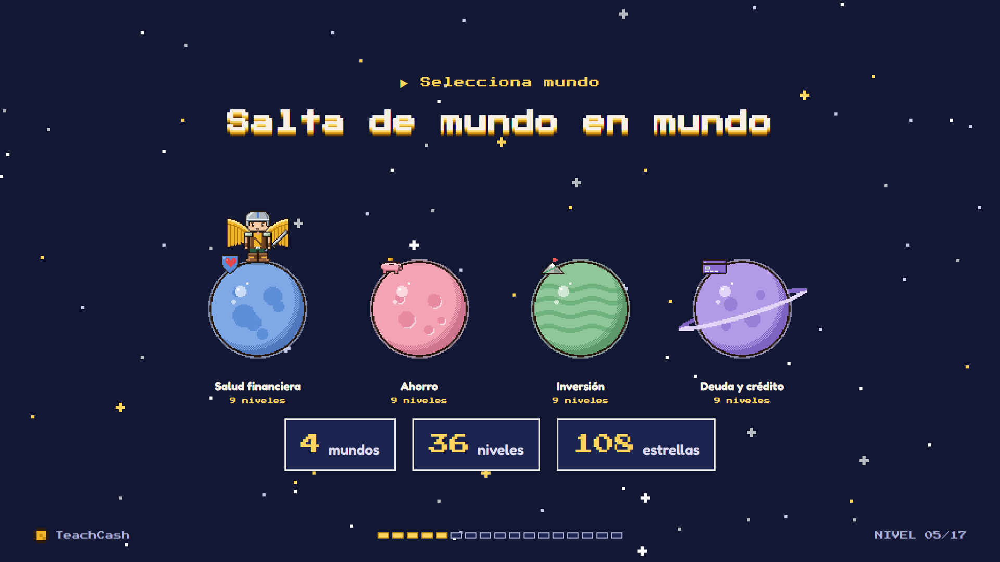
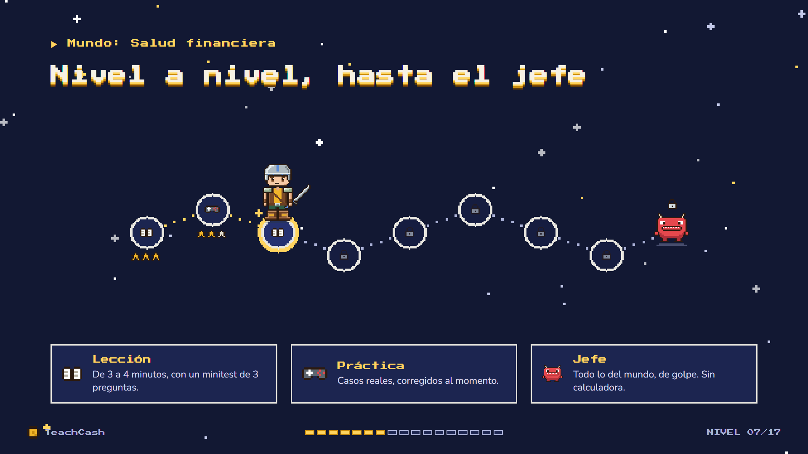
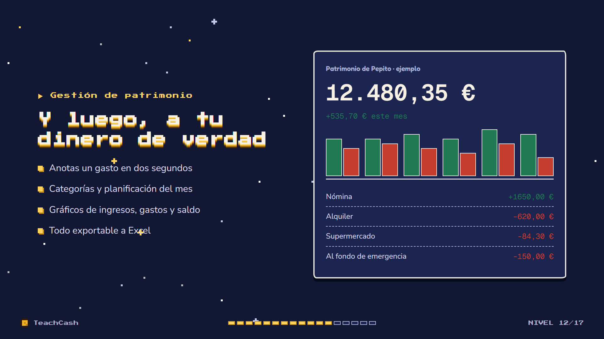

<div align="center">

# 🪙 TeachCash

### Educación financiera al alcance de cualquiera… jugando.

**Un videojuego a píxel para aprender a manejar tu dinero, y un gestor de finanzas para aplicarlo con el tuyo.**
Gratis, sin registrarte y en tres minutos por nivel.

[**▶ Jugar ahora en www.teachcash.es**](https://www.teachcash.es)
&nbsp;·&nbsp; [**Presentación**](#-presentación-y-vídeo)
&nbsp;·&nbsp; [**Vídeo**](#-presentación-y-vídeo)

<br>



<sub>Trabajo de Final de Máster · **The Big School** · Jose Recatalá Pesudo</sub>

</div>

---

## 🐘 El problema

¿Quién te enseñó a manejar el dinero? A mí, nadie.

En clase aprendimos a resolver ecuaciones, pero no a leer una nómina, ni qué es
el TIN, la TAE o el IPC, ni a entender una factura. Y no es una sensación: según
el INE, **el 36,4 % de la gente en España no podría pagar un gasto imprevisto con
sus ahorros** (Encuesta de Condiciones de Vida 2025).

La falta de educación financiera de los jóvenes es el elefante en la habitación
que nadie señala. **TeachCash existe para señalarlo, y para hacer algo al
respecto.**


## 💡 La idea

Si no lo aprendimos en clase, lo aprendemos jugando. TeachCash se apoya en tres
palabras, y ninguna es de adorno:

- 🎮 **Interactivo.** Aquí no se lee un PDF eterno: se practica. Cada lección
  acaba con un minitest y cada error trae su explicación, que es lo que de verdad
  enseña.
- 📚 **Veraz.** Las cifras y las normas son las de España y salen de fuentes
  oficiales: Banco de España, CNMV, INE, Seguridad Social, Tesoro Público y BOE.
  Ningún dato se publica sin revisión humana. Para mí, **un dato mal es un bug**,
  igual que un importe mal sumado.
- ⭐ **Lúdico.** Mundos, jefes, estrellas, una tienda y un héroe que es solo tuyo.
  Aprender tiene que apetecer tanto como jugar el siguiente nivel.

> Es contenido educativo, no asesoramiento financiero, y la aplicación lo
> recuerda en todo el módulo.

---

## 🕹️ Funcionalidades principales

### 1. El Camino del héroe

El corazón de TeachCash. **Cuatro mundos**, cada uno un planeta a píxel, abiertos
desde el principio: empiezas por el que más te preocupe.



| Mundo | Lo que aprendes |
|---|---|
| ❤️ **Salud financiera** | Saber dónde estás: ingresos, gastos, presupuesto, la nómina por dentro y el patrimonio |
| 🐷 **Ahorro** | El colchón para imprevistos, dónde guardar el dinero (cuentas, depósitos, Letras del Tesoro) y cómo crece solo |
| ⛰️ **Inversión** | Riesgo y diversificación, fondos indexados, el efecto de las comisiones y cómo cazar un chiringuito |
| 💳 **Deuda y crédito** | Lo que cuesta de verdad un préstamo, las tarjetas revolving, la hipoteca y cómo salir de una deuda |

Dentro de cada mundo hay un **camino de nueve niveles** que se recorre en orden:

- 📖 **Lección**: tres o cuatro minutos de lectura con un minitest al final.
- 🎮 **Práctica**: casos reales (los de Pepito, el personaje de todos los
  ejemplos), corregidos al momento. Elegir una opción, verdadero o falso, ordenar
  pasos, emparejar conceptos, rellenar el hueco…
- 👾 **Jefe**: el examen final del mundo, contra un monstruo de su color. Seis
  preguntas y un 65 % para tumbarlo. Si pierdes, lo vuelves a intentar: aquí
  equivocarse es gratis, que es justo lo que no pasa con el dinero de verdad.

Sin calculadora: se pregunta por la idea, no por la cuenta.




Cada nivel da de una a tres estrellas y se puede repetir para mejorar la marca.
**Corrige el servidor**, así que las estrellas valen lo que dicen.

### 2. La Tienda: gana estrellas, viste a tu héroe

Las estrellas se gastan en la Tienda: casco, armadura, guantes, botas, espada o
martillo, escudo y alas, en **cuero, hierro y oro**. Hay 108 estrellas en juego y
no llegan para todo, así que toca elegir. (Sí, eso también es educación
financiera.)

Las estrellas solo se ganan aprendiendo: inventarse movimientos no da ninguna.


### 3. El Cuadro de mando: tu héroe crece contigo

La portada de la aplicación: el héroe en su isla con todo su equipo, tu
patrimonio, tus estrellas y un radar con **siete estadísticas**. Los cursos suben
Vitalidad, Defensa, Ataque y Resistencia (una por mundo), y Poder sube con lo que
llevas puesto. Pero **Riqueza y Constancia solo suben si a tu dinero de verdad le
va bien**: el juego se cruza con tu vida.


### 4. Gestión de patrimonio: a tu dinero de verdad

TeachCash no se queda en el juego. El segundo módulo sirve para llevar tus
finanzas reales:

- **Inicio**: tu patrimonio, cómo va el mes frente al anterior, la evolución del
  saldo, en qué se va el dinero y los últimos movimientos. Con flechas para
  recorrer los meses.
- **Movimientos**: anotar un gasto o un ingreso en dos segundos, con categoría y
  fecha. Se filtran por periodo, categoría y texto, y se exportan a Excel.
- **Categorías**: de gasto o de ingreso, con su emoji y su color, que las
  identifican en la tabla y en los gráficos.
- **Planificación**: cada categoría de gasto, con lo gastado este mes frente a su
  presupuesto.

Hay una sola cuenta y una sola moneda: el patrimonio es la cifra con la que
empiezas más la suma de tus movimientos.



### 5. Sin excusas para empezar

- **0 €**: es gratis.
- **0 registros**: entras y juegas. Recibes una sesión de invitado al momento
  (con un CAPTCHA invisible de Cloudflare Turnstile) que dura 4 días.
- **Tus datos, contigo**: si te gusta, creas una cuenta con email y contraseña y
  conservas todo lo que llevas.
- **Tu privacidad**: cada persona ve solo lo suyo y puede borrar su cuenta, con
  todo lo que contiene, desde la propia aplicación.

---

## 🔑 Usuario de prueba

**No hace falta.** TeachCash se usa entero sin registrarse: al entrar en
[www.teachcash.es](https://www.teachcash.es) y pulsar **Jugar gratis** nace una
sesión de invitado con la que se puede probar **todo**: los cuatro mundos, la
tienda, el Cuadro de mando y la gestión de patrimonio. Crear una cuenta solo
sirve para conservar los datos más allá de los 4 días del invitado.

---

## 🌍 Despliegue

| | |
|---|---|
| **Aplicación en producción** | **[www.teachcash.es](https://www.teachcash.es)** |
| **Hosting** | Vercel: cada merge a `main` se despliega solo |
| **Base de datos y auth** | Supabase (Postgres en la región eu-west-3, París) |
| **Emails** | Resend, desde `no-reply@teachcash.es` |
| **Dominio** | `teachcash.es` (la raíz y `teachcash.vercel.app` redirigen a `www`) |

El paso a paso del despliegue, con las variables de entorno y la configuración de
cada panel, está en [`docs/plans/PLAN-DESPLIEGUE.md`](docs/plans/PLAN-DESPLIEGUE.md).

## 🎬 Presentación y vídeo

- **Presentación (web, con animaciones)**: [www.teachcash.es/presentacion](https://www.teachcash.es/presentacion).
  Está hecha con las mismas piezas del juego, no con capturas. Se maneja con las
  flechas, **F** pone la pantalla completa y **N** enseña las notas.
- **[Presentación en Google Slides](https://docs.google.com/presentation/d/1fgsaO5C3leoC9E_JZaVcdHqoboAiZN6i/edit?usp=sharing)**
- **Vídeo explicativo**: _enlace pendiente_
- **Repositorio**: [github.com/joseRecatalaa/TeachCash](https://github.com/joseRecatalaa/TeachCash)

---

## 🧰 Stack tecnológico

| Pieza | Elección | Para qué |
|---|---|---|
| Framework | **Next.js 16** (App Router, Turbopack) | Rutas, renderizado en servidor y Server Actions |
| Interfaz | **React 19** + **TypeScript 5** en modo `strict` | Tipado de punta a punta |
| Datos en el cliente | **Refine.dev 5** + **React Query 5** | CRUD declarativo sobre un DataProvider propio |
| Componentes | **Mantine 9** + `mantine-datatable` | Formularios, tablas y modales, con un tema dibujado a mano |
| Estilos | **CSS Modules** + tokens `--sd-*` | Un sistema de diseño propio, con modo claro y oscuro |
| Tipografía | Fredoka, Nunito, Geist Mono y Press Start 2P | Titulares, texto, dinero (cifras de ancho fijo) y el mundo de píxel |
| Base de datos | **Postgres en Supabase** + **Drizzle ORM** | Consultas tipadas, migraciones y RLS |
| Transporte | **Server Actions** | Sin API REST: menos superficie y la sesión se comprueba en un solo sitio |
| Validación | **Zod 4** | Todo lo que llega del cliente se valida en el servidor |
| Autenticación | **Supabase Auth** (`@supabase/ssr`) | Invitados anónimos y cuentas con email, cookies `httpOnly` |
| Anti-bots | **Cloudflare Turnstile** (invisible) | Al crear el invitado |
| Gráficos | **Recharts 3** | Evolución del saldo, gasto por categoría, ingresos frente a gastos |
| Exportación | **xlsx** (SheetJS) | Movimientos a Excel, con carga diferida |
| Pixel art | **SVG propio** | Héroe, equipo, mundos y jefes dibujados en código: ni una sola imagen |
| Tests | **Vitest** + fast-check + **PGlite**, Testing Library, **Playwright** | Unitarios, de integración contra un Postgres real y E2E |
| Calidad | **GitHub Actions** + Husky + lint-staged | CI en cada PR y comprobaciones en cada commit |
| Despliegue | **Vercel** | Producción en `www.teachcash.es` |
| Paquetes | **pnpm 10** | |

## 🛡️ Lo que hay debajo (y de lo que estoy orgulloso)

- **Más de 1.500 tests** en 87 ficheros: unitarios, de integración contra un
  Postgres de verdad (PGlite, en proceso) y tests de componentes. Además, los flujos
  clave cubiertos de punta a punta con **Playwright** contra un Supabase de
  pruebas.
- **Un CI que vigila cada merge** a `develop`: tipos, lint, tests con umbrales de
  cobertura por fichero, la suite entera en otro huso horario, build y
  `pnpm audit`. Nada entra sin pasar.
- **Auditoría de seguridad** contra OWASP Top 10 y OWASP API Top 10: CSP con
  nonce, cookies `httpOnly`, RLS de solo lectura en todas las tablas, límites de
  peticiones y cuotas por usuario. Todo documentado en
  [`docs/SECURITY.md`](docs/SECURITY.md).
- **El dinero, siempre en céntimos enteros**, nunca un decimal. Así
  `0,1 + 0,2` da `0,3`.
- **Clean Architecture en cuatro capas**, con las fronteras vigiladas por ESLint.
- **Pixel art 100 % propio**, sin un solo fichero de imagen: sigue el modo oscuro
  y no toca la CSP.

---

## 🚀 Instalación y ejecución en local

### Requisitos

- **Node.js 20.9 o superior** (lo exige Next.js 16).
- **pnpm 10** (`npm install -g pnpm`). Usa siempre `pnpm`: con `npm` o `yarn` se
  corrompe el lockfile.
- Un proyecto de **Supabase** (el plan gratuito vale).
- Un widget de **Cloudflare Turnstile** en modo invisible (también gratis).

Qué configurar en cada panel está explicado en
[`docs/plans/PLAN-SUPABASE.md`](docs/plans/PLAN-SUPABASE.md).

### Pasos

```bash
git clone https://github.com/joseRecatalaa/TeachCash.git
cd TeachCash
pnpm install                 # instala también el hook de commit (Husky)
cp .env.example .env.local   # y rellénalo: cada variable dice de dónde sale
pnpm db:migrate              # crea las tablas, RLS y políticas en Supabase
pnpm dev                     # → http://localhost:3000
```

Las variables de `.env.local` son estas (en [`.env.example`](.env.example) cada
una explica de qué panel sale):

| Variable | Qué es |
|---|---|
| `DATABASE_URL` | Conexión de Supabase por el *Transaction pooler* (puerto 6543), la que usa la app |
| `DATABASE_URL_MIGRATIONS` | Conexión por el *Session pooler* (puerto 5432), la que usan las migraciones |
| `NEXT_PUBLIC_SUPABASE_URL` | La URL del proyecto de Supabase |
| `NEXT_PUBLIC_SUPABASE_PUBLISHABLE_KEY` | La clave pública de Supabase |
| `NEXT_PUBLIC_TURNSTILE_SITE_KEY` | La clave del widget de Turnstile |
| `APP_URL` | La URL pública de la app. Obligatoria en producción; en local puede ir vacía |

No hay paso de semillas: cada usuario recibe sus categorías por defecto al nacer,
y los cursos se leen de `content/heroe/`.

Por último, una sola vez: en el SQL Editor de Supabase, con la extensión
`pg_cron` activada, ejecuta `db/sql/limpieza-invitados.sql`. Es el job que borra
cada hora los invitados caducados.

### Comandos

| Comando | Qué hace |
|---|---|
| `pnpm dev` | Servidor de desarrollo en `localhost:3000` |
| `pnpm build` / `pnpm start` | Build de producción y servirlo |
| `pnpm test` | Los tests de Vitest (sobre PGlite: no tocan Supabase) |
| `pnpm test:tz` | Los mismos tests en el huso horario de Kiritimati, que caza fechas mal tratadas |
| `pnpm test:coverage` | Los tests con los umbrales de cobertura |
| `pnpm test:e2e` | Los E2E con Playwright (necesitan `.env.e2e`) |
| `pnpm typecheck` / `pnpm lint` | Tipos y ESLint |
| `pnpm heroe:validar` | Valida el contenido de los cursos |
| `pnpm db:generate` / `pnpm db:migrate` | Generar y aplicar migraciones |
| `pnpm db:studio` | Explorador de la base de datos |
| `pnpm generate:crud` | Scaffolding completo de una entidad nueva |
| `pnpm presentacion:exportar` | Exporta la presentación a PDF y PNG (con la app en marcha) |

---

## 🗂️ Estructura del proyecto

```
TeachCash/
├── app/                     # Rutas de Next.js (App Router)
│   ├── page.tsx             #   / → portada pública sin sesión, Cuadro de mando con ella
│   ├── CaminoHeroe/         #   el juego: mapa de mundos, camino y niveles
│   ├── Tienda/              #   la tienda de equipo
│   ├── Patrimonio/          #   gestión de patrimonio: Inicio
│   ├── Movimientos/         #   movimientos (listado, crear, editar)
│   ├── Categorias/          #   categorías
│   ├── Planificacion/       #   presupuesto frente a gasto
│   ├── aprende/             #   cursos públicos, para Google
│   ├── presentacion/        #   la presentación del TFM
│   └── Login/, Registro/…   #   cuenta y contraseña
├── content/heroe/           # Los CURSOS, en JSON: un mundo por carpeta, un nivel por fichero
├── src/                     # Clean Architecture en cuatro capas
│   ├── types/               #   DTO y esquemas Zod compartidos
│   ├── infrastructure/      #   repositorios: el único sitio que valida, autoriza y escribe
│   ├── application/         #   Server Actions (la frontera), hooks y proveedores
│   └── presentation/        #   componentes, formularios y tablas declarados, pixel art
├── lib/                     # Dinero, fechas, formato, auth, CSP, estadísticas, tienda…
├── db/                      # Esquema de Drizzle, migraciones y SQL de mantenimiento
├── e2e/                     # Tests end-to-end con Playwright
├── test/                    # Andamiaje de Vitest (PGlite, mocks, render)
├── scripts/                 # Exportar la presentación a PDF, PNG y PPTX
├── docs/                    # Toda la documentación técnica (ver abajo)
│   └── presentacion/        #   la presentación exportada (PDF, PPTX, PNG)
└── proxy.ts                 # Refresca la sesión y pone la CSP en cada petición
```

El mapa completo, fichero a fichero, está en [`docs/STRUCTURE.md`](docs/STRUCTURE.md).

### Documentación técnica

| Documento | De qué va |
|---|---|
| [`AGENTS.md`](AGENTS.md) | Las reglas duras del proyecto, las trampas y todas las decisiones tomadas |
| [`docs/ARCHITECTURE.md`](docs/ARCHITECTURE.md) | Las capas, cómo viajan los datos y la sesión |
| [`docs/COMPONENTS.md`](docs/COMPONENTS.md) | El sistema de diseño y los componentes reutilizables |
| [`docs/STRUCTURE.md`](docs/STRUCTURE.md) | Dónde va cada cosa |
| [`docs/TESTS.md`](docs/TESTS.md) | Cómo está montada cada suite de tests y qué cubre |
| [`docs/SECURITY.md`](docs/SECURITY.md) | Las medidas de seguridad, punto por punto de OWASP |
| [`docs/CONTENIDO-HEROE.md`](docs/CONTENIDO-HEROE.md) | Cómo se escribe un curso |
| [`docs/plans/`](docs/plans/) | Los planes con los que se construyó, incluido el despliegue |

---

## 🗺️ Lo que viene

El Trabajo de Final de Máster se acaba. **El proyecto, no.** Voy a seguir con él:

- 👾 **Más mundos, más jefes.**
- 🎮 **Más funcionalidades.**
- ❤️ **Formar una comunidad** alrededor de TeachCash.

<div align="center">

<br>

### Continue? ▶

**[www.teachcash.es](https://www.teachcash.es)**: tu héroe te está esperando.

</div>
